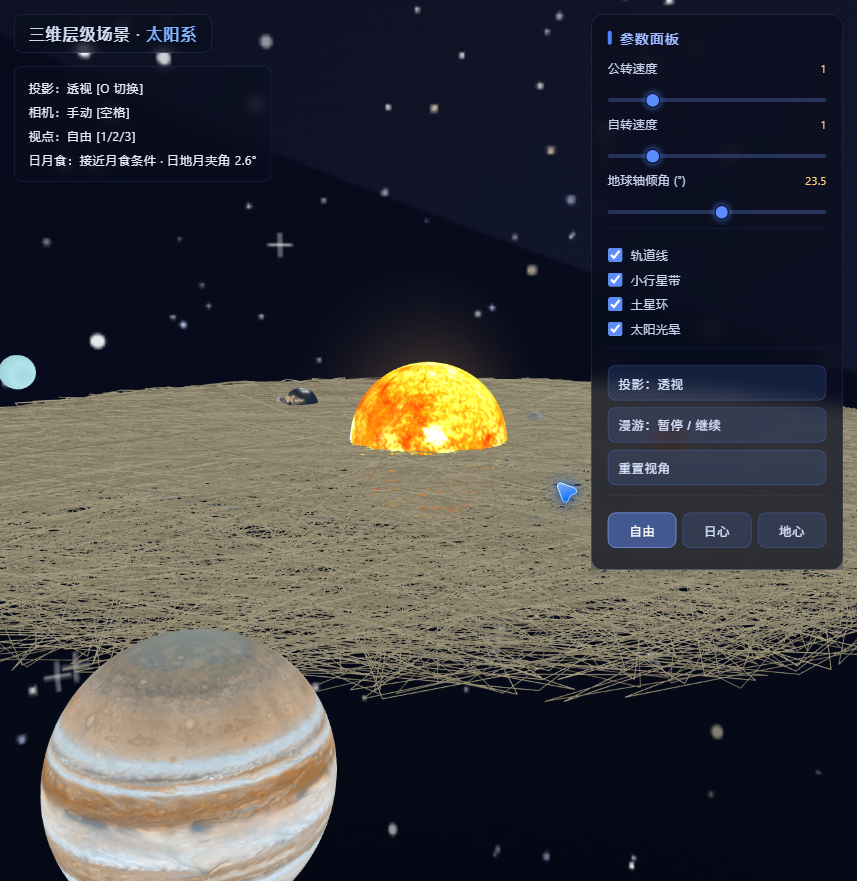
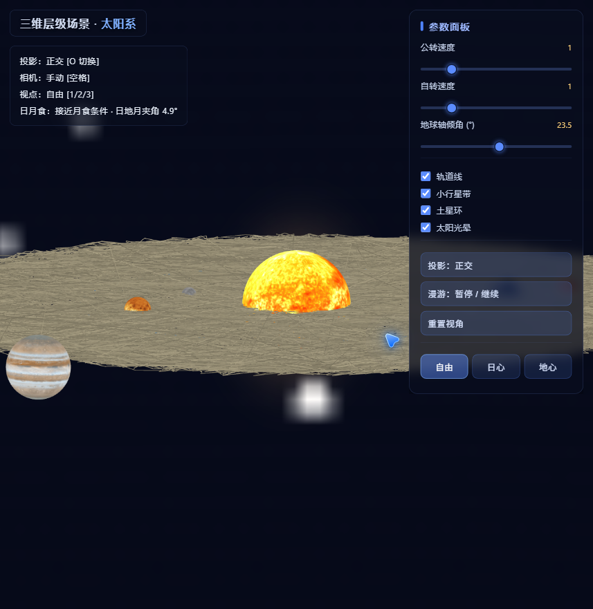

# AP2 · 三维层级场景：太阳系

> 计算机图形学课程项目 AP2 —— 原生 WebGL2 实现的三维层级场景（太阳系）。
> 必做（8 分）+ 选做（E1/E2/E3，+2 分）全部完成，代码零第三方依赖（仅使用教材风格手写矩阵库 `Common/MV.js`），无需构建步骤，浏览器直接运行。

---

## 一、运行方式

项目为纯前端静态资源，任选一种静态文件服务器即可运行（推荐方式 1）：

```powershell
# 方式 1：Python 内置服务器（项目根目录下执行）
python -m http.server 8000
# 浏览器打开 http://localhost:8000
```

```bash
# 方式 2：任意静态服务器（如 npx serve / VS Code Live Server）
npx serve .
```

> 注意：请勿直接双击 `index.html`（`file://` 协议），WebGL 纹理加载与跨域行为在 `file://` 下不稳定，必须通过 HTTP 访问。

**在线体验（公网 URL）**：https://kai460538-create.github.io/AP2-SolarSystem/

---

## 二、功能总览（必做 6 项 + 选做 3 项）

| 类别 | 功能 | 完成情况 |
|---|---|---|
| 必做 1 | 太阳–地球–月球三级嵌套层级（先转后挂） | ✅ |
| 必做 2 | 地球自转轴倾角 23.5°，"先转后挂"变换顺序 | ✅ |
| 必做 3 | 月球轨道面倾角 5.145°，手造矩阵构造 | ✅ |
| 必做 4 | 太阳/地球/月球三张纹理 + 上下颠倒处理 | ✅ |
| 必做 5 | O 键双投影（透视/正交）切换 | ✅ |
| 必做 6 | 环绕漫游 + 空格暂停/继续，可被鼠标接管 | ✅ |
| 必做 7 | 参数面板：公转/自转/倾角滑条 + 轨道线开关 | ✅ |
| 选做 E1 | 完整太阳系：8 大行星 + 土星环 + 3000 颗小行星带 | ✅ |
| 选做 E2 | 日月食模拟：日心/地心视点切换 + 光影说明（HUD 判定） | ✅ |
| 选做 E3 | 虚拟轨迹球视角控制（拖拽旋转 + 滚轮缩放） | ✅ |

---

## 三、操作说明

| 操作 | 按键 / 控件 | 说明 |
|---|---|---|
| 投影切换 | `O` 键 或 面板按钮 | 透视 ⇄ 正交（同视野匹配，见第五节） |
| 漫游暂停/继续 | `空格` 或 面板按钮 | 40s 环绕漫游；暂停/恢复时按当前方位取整，无跳变 |
| 视点切换 | `1` / `2` / `3` 或 面板按钮 | 自由视点 / 日心（看地球绕太阳）/ 地心（看月球绕地球） |
| 轨迹球旋转 | 鼠标左键拖拽 | 绕观察目标旋转；拖拽时自动暂停漫游接管相机 |
| 缩放 | 鼠标滚轮 | 沿视线方向推拉，保留当前旋转姿态 |
| 重置视角 | `R` 键 或 面板按钮 | 回到默认漫游起点 |
| 帮助浮层 | `H` 键 | 显示/隐藏操作说明 |
| 公转/自转速度 | 面板滑条 0.1–5.0 | 全局缩放地球与行星运动速度 |
| 地球轴倾角 | 面板滑条 0–45°（默认 23.5°） | 实时调整地轴倾斜 |
| 轨道线/小行星带/土星环/太阳光晕 | 面板复选框 | 显隐开关 |

---

## 四、实现要点

### 4.1 层级变换：先转后挂（评分核心）

**"先转后挂"** 的含义：先构建子对象**相对父级的局部变换**（先转），再把该局部变换**左乘父级的世界变换**挂到父级坐标系下（后挂）。父级运动时，子对象整体跟随；子对象自身的旋转只改变相对父级的姿态。

场景的变换嵌套树如下（箭头表示 `M_child = M_parent · M_local`）：

```
世界
└─ 太阳系坐标系（绕 Y 轴公转 / 静态）
   ├─ 太阳：             Model = R_y(太阳自转) · S(8)
   │    └─ 光晕（billboard 始终面向相机，顶点着色器旋转）
   ├─ 地球轨道系（绕 Y 公转）： OrbitE = R_y(θ_公转) · T(0,0,-32)
   │    └─ 地球：         Model = OrbitE · R_x(23.5°) · R_y(θ_自转) · S(1.8)
   │         └─ 月球轨道系（绕 Y 公转 + 绕 X 倾斜 5.145°）：
   │              OrbitM = R_x(5.145°) · R_y(θ_公转) · T(0,0,-3.4)
   │              └─ 月球： Model = OrbitE · OrbitM · R_y(θ_自转) · S(0.55)
   ├─ 水星 … 海王星（同构）：Model = R_y(θ_i) · T(0,0,-d_i) · R_y(φ_i) · S(r_i)
   │    └─ 土星环：挂在土星 Model 之下，随土星一起运动
   └─ 小行星带：3000 个点精灵，程序生成（见 E1）
```

要点说明：

1. **地球 23.5° "先转后挂"**：`R_x(tilt)` 夹在轨道矩阵与自转矩阵之间（`OrbitE · R_x(23.5°) · R_y(spin)`），因此倾角只影响地球自身姿态（自转轴始终倾斜 23.5°），不影响地球公转轨道的朝向——这正是"自转轴倾角"与"轨道面倾角"的区分。
2. **月球轨道面倾角（手造矩阵）**：`OrbitM = R_x(5.145°) · R_y(θ) · T(0,0,-3.4)`。先用 `R_y(θ)` 造出"月球在水平面内绕地球公转"的矩阵，再左乘 `R_x(5.145°)` 把整个轨道面绕 X 轴倾斜 5.145°（真实月球轨道对黄道面的倾角）。该矩阵挂在**地球公转系**（`OrbitE`）之下、地球自转之外，所以白道面随地球公转平移、但不受地球自转影响，且倾斜方向稳定。
3. **各行星同构复用**：水星～海王星使用与地球相同的 `R_y(θ)·T(0,0,-d)` 公转模式，轨道距离/周期/半径由 `js/config.js` 集中配置（演示尺度，非真实比例）。

### 4.2 手写矩阵库 `Common/MV.js`（对应教材 Ch4）

项目未使用 Three.js 等引擎，全部矩阵运算由自写列主序（column-major）`mat4` 库完成，API 与教材《交互式计算机图形学》配套的 `MV.js` 风格一致（角度制 `rotate`）：

- `vec3/vec4/mat4` 类型构造；`mult(A,B)=A·B`（列主序存储，先应用右侧矩阵）；`translate/rotate/scale`。
- `rotate(angle, x, y, z)`：角度制、右手系，按 Rodrigues 公式生成绕任意轴旋转矩阵。
- `lookAt(eye, at, up)`：以 `up` 与视线叉积求 `u`（右）、`v`（上）、`n`（-视线）三基向量构成旋转部分，平移列为 `-R·eye`。**反解公式**（用于轨迹球等）：设视图矩阵平移列 `t=(v12,v13,v14)`，则 `eye = -(u·t, v·t, n·t)`，其中 `u=(v0,v4,v8)`、`v=(v1,v5,v9)`、`n=(v2,v6,v10)`；视线方向 `fwd = -n`。
- `perspective(fovy, aspect, near, far)` / `ortho(l, r, b, t, near, far)`：**正交与透视同视野匹配**，正交半高取 `dist·tan(fovy/2)`（相机到目标距离 × 视场角正切），保证两种投影下太阳等天体在画面中的视尺寸一致，仅"近大远小"效果不同（见 4.4 对比图）。

开发期用 `_math_test.js`（node + vm 沙箱）对矩阵库做了 8 项独立数学自测并全部通过：lookAt 反解相机位置、视线方向、轨迹球"原地转头"、mult 先平移后旋转顺序、perspective 形状、23.5° 倾角矩阵验证等。

### 4.3 纹理与"上下颠倒"处理

- 三张必做纹理（太阳 `2k_sun`、地球 `2k_earth_daymap`、月球 `2k_moon`）及水星～海王星、土星环全部为真实 NASA 影像贴图（来源见第八节），分辨率 2048×1024，环为 2048×125 RGBA（含透明通道）。
- 纹理在 GPU 中的约定是 **UV 原点在左上角、v 轴向下**，而图像文件（JPEG/PNG）按"第一行在上"存储。若不处理，贴图会**上下颠倒**。本项目统一在纹理上传前设置：

```js
gl.pixelStorei(gl.UNPACK_FLIP_Y_WEBGL, true);   // 翻转 Y，纠正上下颠倒
```

- 所有纹理异步加载、`generateMipmap` 生成多级纹理，全部就绪后才启动渲染循环；星空背景用 Canvas 程序化生成（数百颗随机恒星），避免额外纹理请求。

### 4.4 双投影对比（透视 vs 正交）

- **透视投影**：`perspective`，远处物体按近大远小缩小，轨道椭圆在斜视角下呈透视缩短效果，适合沉浸式漫游。
- **正交投影**：`ortho`，平行线保持平行、无近大远小，同一距离的天体视尺寸相等，适合观察轨道几何关系与层级结构。

同视角对比（漫游暂停状态，仅切换 `O` 键）：


*透视：太阳更大、行星近大远小、轨道线有透视缩短*


*正交：太阳视尺寸相对变小、无近大远小、轨道线呈规则圆*

差异说明：同样的相机位置与视野下，透视投影中太阳（半径 8，距离 0）与近处行星的尺寸差被放大；正交投影中所有平行方向的尺寸按同一比例，画面"更平"，天体相对大小更能反映真实距离比。

### 4.5 环绕漫游与视点（含 E2 日月食）

- **漫游**：相机沿 40s 周期的圆形轨迹环绕太阳系，`lookAt` 始终对准场景原点，轨迹高度带正弦起伏；`空格`暂停/继续，恢复时从当前方位角取整继续，无跳变。
- **E2 日月食模拟**：`1/2/3` 切换自由/日心/地心三种视点。日心视点把相机放到太阳附近看地球公转；地心视点把相机放到**月球外侧**（沿地月连线越过月球约 6 单位、略抬升俯视），完整呈现月球并清晰展示其自转与绕地公转，地球与白道轨道同镜。渲染循环中实时计算**日-地-月夹角**并写入 HUD：夹角接近 0°（三体近似共线、月球在日地之间）判定为"接近日食条件"，接近 180°（月球在日地延长线上）判定为"接近月食条件"——对应真实日月食的成因说明（日食是月球遮住太阳，月食是地球影子遮住月球）。

### 4.6 E3 虚拟轨迹球

- 鼠标按下时把屏幕坐标映射到**单位球面**（归一化到 [-1,1] 并求球面 z 分量），两次拖拽位置叉积得到**旋转轴**，点积反余弦得到**旋转角**；旋转矩阵**前乘**当前视图矩阵，实现"绕观察目标转动视线"。旋转轴方向取反，使**拖拽方向与场景转向一致**（向右拖场景向右转，符合日常操作习惯）。
- 拖拽开始自动暂停漫游（相机接管），拖拽结束保持手动状态，`R` 或按钮可恢复默认漫游；滚轮沿视线缩放，缩放保留当前旋转姿态。

---

## 五、文件结构

```
AP2/
├─ index.html            # 唯一入口：4 组 GLSL ES 300 着色器（行星/轨道线/点精灵/billboard 光晕）、面板与 HUD
├─ Common/
│  ├─ MV.js              # 手写列主序 mat4 工具库（教材风格，角度制 rotate）
│  └─ initShaders.js     # 着色器编译/链接工具
├─ js/
│  ├─ config.js          # AP2_CONFIG：天体尺寸/轨道距离/周期/纹理路径集中配置
│  ├─ geometry.js        # 球体 UV、圆环（土星环）、小行星带、billboard 几何
│  ├─ textures.js        # 纹理异步加载（FLIP_Y + mipmap）、Canvas 星空
│  ├─ camera.js          # 漫游 / 轨迹球 / 双投影 / 视点切换 / 缩放 / 重置
│  ├─ ui.js              # 面板绑定、键盘鼠标事件、HUD 更新
│  └─ main.js            # 渲染循环、computeScene 层级矩阵、日月食判定、启动
├─ textures/             # 12 张 NASA 纹理（2048×1024，环 2048×125 RGBA）
├─ screenshots/          # 双投影对比、日心/地心视点截图、10s 漫游录屏 GIF
└─ _math_test.js         # （开发自测）矩阵库 8 项数学测试，node 直接运行
```

---

## 六、验证情况

- **矩阵层**：`node _math_test.js Common\MV.js` → 8/8 PASS（含 lookAt 反解、轨迹球、先转后挂倾角）。
- **渲染层**：本地 HTTP 服务 + Chrome 实测通过；星空背景、太阳光晕、8 行星纹理、轨道线、3000 颗小行星带、参数面板、HUD 全部可见。
- **交互层**：O 键双投影切换、空格漫游暂停/继续、1/2/3 视点切换、鼠标拖拽轨迹球接管、滚轮缩放、滑块（公转/自转/倾角）、轨道线开关均已在浏览器中逐项验证（截图见 `screenshots/`）。
- **10 秒漫游录屏**：`screenshots/orbit_10s.gif`（10 帧 × 1s，浏览器实机录制）。

---

## 七、代码出处

- 本项目为**原创代码**，未使用 Three.js/OrbitControls 等现成库。
- 矩阵库 API 风格参考教材《交互式计算机图形学——基于 OpenGL 的自顶向下方法》（Edward Angel）配套 `MV.js` 的接口约定（列主序、角度制 rotate），实现为自行推导编写。
- 数学自测脚本、层级变换、相机系统、日月食判定均为本项目独立实现。

---

## 八、纹理来源

| 纹理 | 来源 | 许可 |
|---|---|---|
| 太阳 / 月球 / 水星 / 金星 / 火星 / 木星 / 土星 / 天王星 / 海王星 / 土星环 | Solar System Scope — solarsystemscope.com/textures/ | CC BY 4.0 |
| 地球（含云层大气） | threejs.org/examples/textures/planets/earth_atmos_2048.jpg | three.js 示例资源 |

纹理版权归原作者所有，本项目仅作课程学习用途。
